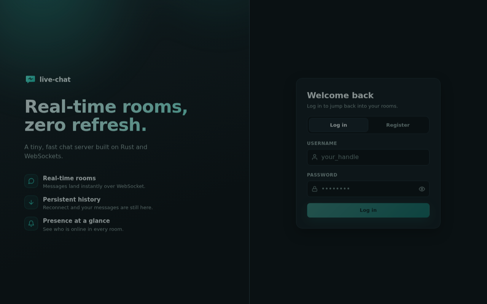
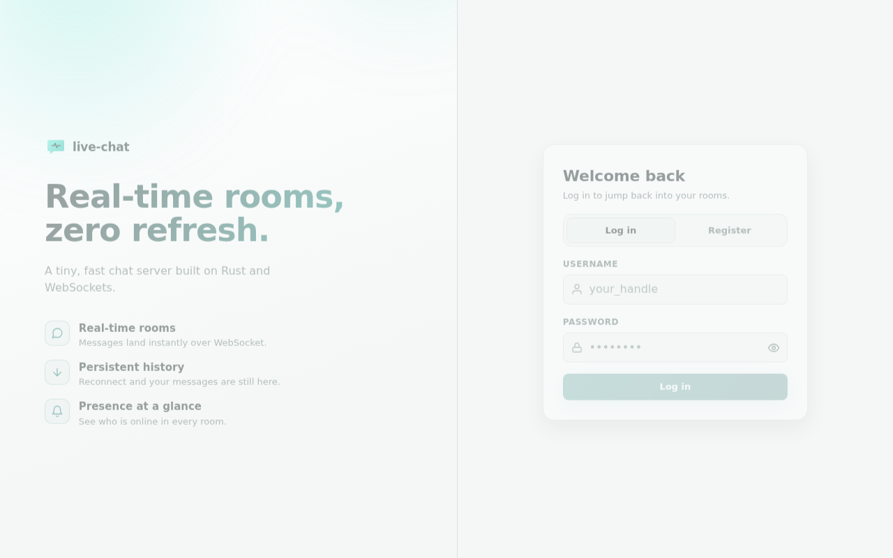
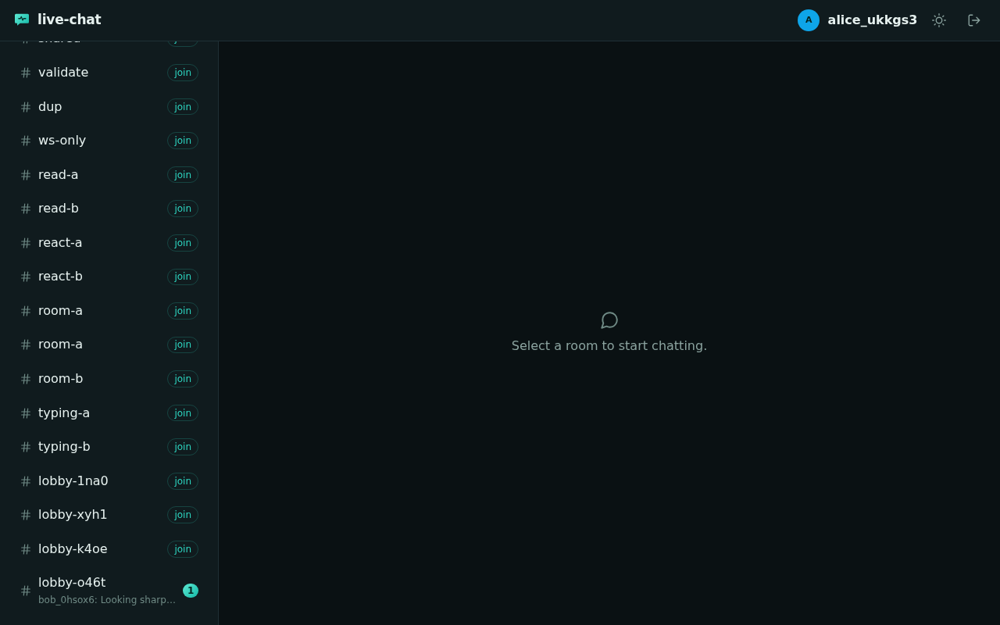
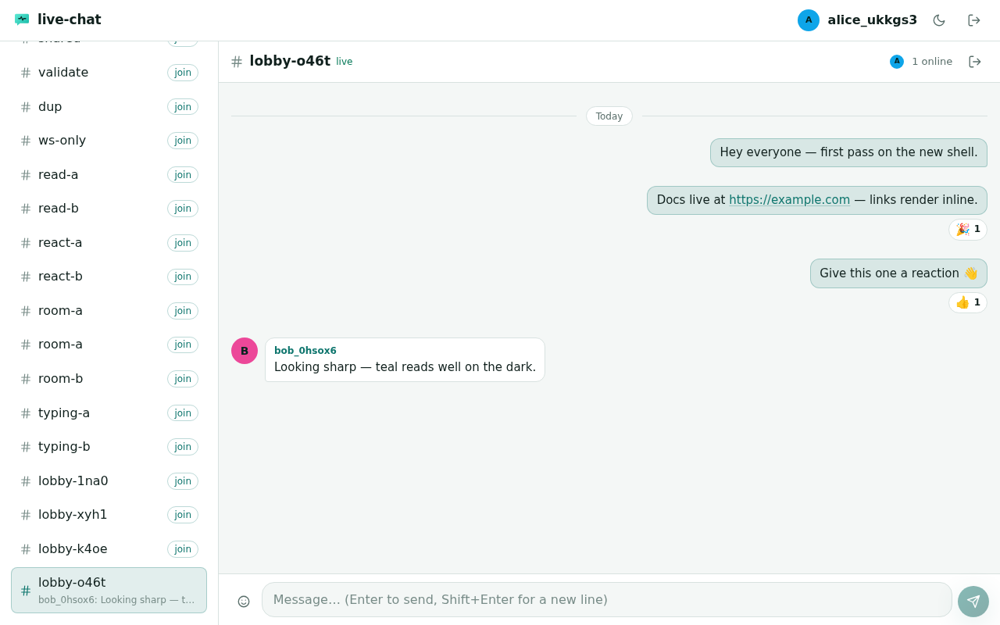
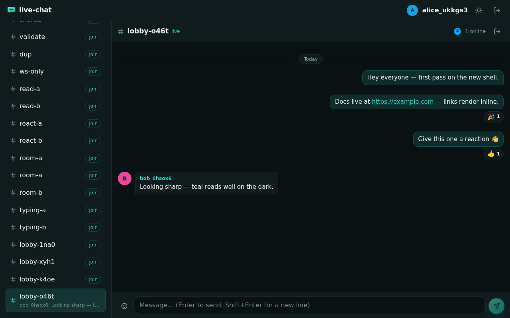
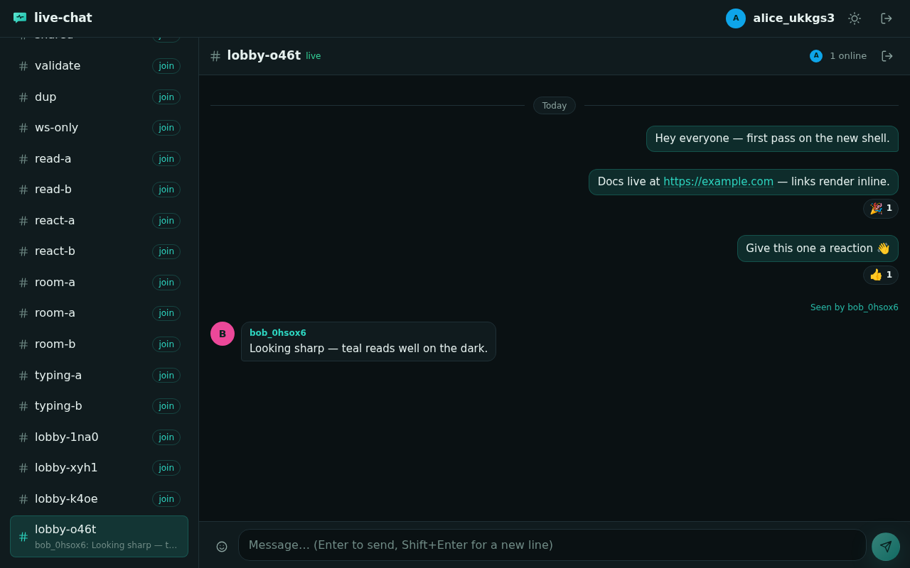
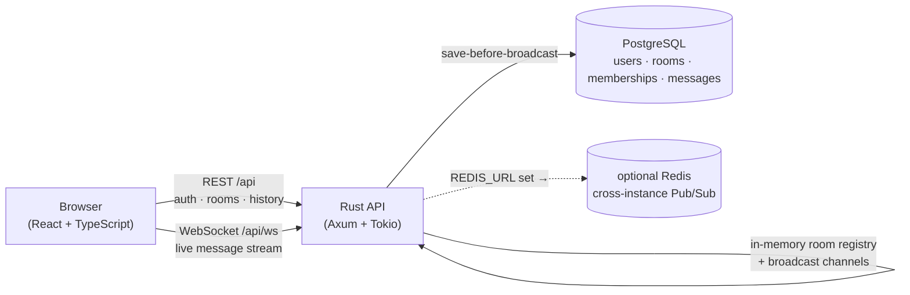

<div align="center">


# live-chat-server

**Real-time chat with a Rust backend and a React + TypeScript client.**
WebSockets, JWT auth, room-based access control, and message persistence in PostgreSQL.


</div>

---

## Table of contents

- [About](#about)
- [Features](#features)
- [Screenshots](#screenshots)
- [Architecture](#architecture)
- [How to use](#how-to-use)
- [How to develop](#how-to-develop)
- [Tech stack](#tech-stack)
- [Author](#author)
- [License](#license)

## About

`live-chat-server` is an intermediate Rust project that demonstrates asynchronous
networking end to end: WebSockets for live messaging, PostgreSQL for durable
storage, JWT authentication, and room-based access control — paired with a
React + TypeScript client that speaks a typed protocol to the server.

Users can register, log in, create or join chat rooms, exchange messages in real
time, react to messages, and see full history after reconnecting. The system is
built **single-server first** (in-memory room registry + broadcast channels);
setting `REDIS_URL` switches it to cross-instance Pub/Sub broadcasting.

A few design properties carry through the whole codebase:

- **Save before broadcast** — every message is persisted to PostgreSQL before it
  is delivered over WebSockets.
- **Consistent identity** — messages carry IDs and timestamps, so clients render
  history identically after every reconnect.
- **Be defensive everywhere** — message-size limits, input validation, and
  membership re-checks apply to every action, not just the happy path.
- **Observable** — structured `tracing` logs for connects, disconnects, errors,
  and broadcasts; `/health` liveness probe.

Full HTTP + WebSocket protocol reference: **[`docs/api.md`](docs/api.md)**.

## Features

**Backend — Rust, Axum + Tokio**

- Auth: register / login with **argon2id** hashing and **JWT (HS256, 24 h)**
  bearer tokens; `/api/me`.
- Rooms: create, list, get, join/leave (idempotent); open enrollment — a room
  name is enough to join.
- History: paginated messages (`limit` + `before` cursor), newest first,
  members only.
- Real-time chat: WebSocket with pre-upgrade auth + access checks, per-room
  broadcast, save-before-broadcast persistence, presence join/leave events,
  revoked-membership teardown, reactions, typing events, and read receipts.
- Storage: SQLx with compile-time-checked queries against PostgreSQL;
  migrations bundled and applied on startup.
- Optional Redis Pub/Sub fan-out when `REDIS_URL` is set (graceful in-memory
  fallback otherwise).

**Frontend — React 19 + TypeScript (Vite)**

- Register / login with live username and password validation.
- Room list with search and unread-count badges; create and join rooms.
- Live chat: streaming messages, load-older pagination, reactions with an
  emoji picker, typing indicators, presence, and read receipts ("Seen by...").
- Resilient WebSocket client with reconnect + backoff; history reload on resume.
- Dark / light themes (persisted), command palette (`Ctrl/Cmd + K`), toasts,
  desktop notifications, keyboard navigation, and screen-reader labels.
- Typed REST + WebSocket client with response normalization, 92 unit tests.

## Screenshots

Dark and light themes, captured against a seeded room with reactions and a
"Seen by bob" receipt.

| Dark theme | Light theme |
|---|---|
|  |  |
|  |  |
|  |  |

## Architecture



The client only ever talks to the Vite dev server, which proxies `/api`
(HTTP + WebSocket) and `/health` to the backend — no CORS during development.
WebSocket frames are normalized by a typed client so the UI and the server
agree on optional fields even across server versions.

## How to use

The easiest way to see it running is Docker Compose:

```bash
make dev-up        # Postgres + API (:8083) + frontend (:5173)
```

1. Open <http://localhost:5173>.
2. Register a username and password (any unique username works).
3. Create a room — or ask a friend for a room name and join it.
4. Chat: messages, emoji reactions, typing indicators, read receipts.
5. Close the tab and come back: history is persisted in PostgreSQL, and the
   client reloads it over the WebSocket on reconnect.

Stop everything with `make dev-down`.

No Docker? Run the pieces directly — see [How to develop](#how-to-develop).

## How to develop

### Prerequisites

- **mise** (or your own toolchain): Rust 1.99+, Node.js 24+, npm
- **Docker** + Docker Compose for `make dev-up`, or a local PostgreSQL

### Quick start

```bash
make dev-up         # full stack with one command
```

Or run each component by hand — backend first (it runs migrations on startup):

```bash
cd backend
cargo fetch
cargo run           # reads DATABASE_URL + PORT (default 8080)
```

```bash
cd frontend
npm ci
npm run dev         # Vite on :5173, proxies /api to the backend
```

If the backend is not on `:8080`, point the proxy at it:

```bash
cd frontend
VITE_API_PROXY_TARGET=http://localhost:8083 npm run dev
```

### Commands

| Command | What it does |
|---|---|
| `make check` | Every gate: backend fmt/clippy/test/build (`--locked`) + frontend format/lint/typecheck/test/build |
| `make dev-up` / `make dev-down` | Start / stop the Compose stack |
| `make screenshots` | Playwright capture harness (needs the stack running) |
| `cd backend && cargo test` | Backend unit + integration tests (WS, pub/sub, read receipts) |
| `cd backend && sqlx migrate run` | Apply migrations manually |
| `cd frontend && npm run test` | Frontend Vitest unit tests |
| `cd frontend && npm run build` | Type-check + production build |

Ports used by the Compose stack (override via `.env`):

| Service | Host | Container |
|---|---|---|
| API | 8083 | 8080 |
| Frontend | 5173 | 5173 |
| PostgreSQL | 5434 | 5432 |
| Redis (optional) | 6381 | 6379 |

### Screenshots

The harness (`frontend/scripts/screenshots.mjs`) seeds a two-user room over the
public API and WebSocket — messages, reactions, a read receipt — then captures
the six PNGs shown above. It is not part of `make check` and CI never runs it.

```bash
npm ci
npx playwright install chromium     # one-time; on Linux usually needs --with-deps (requires sudo)
make dev-up                          # stack must be running
SCREENSHOTS_DIR=docs/screenshots make screenshots   # committed output
```

The default output directory is `frontend/screenshots/` (gitignored); the
published images live in `docs/screenshots/` (committed) — hence the
`SCREENSHOTS_DIR` override above. `VITE_ORIGIN` points the browser elsewhere if
your stack is not on `:5173`.

## Tech stack

| Layer | Choice |
|---|---|
| Backend | Rust — **Axum 0.8** on Tokio, **SQLx 0.9** (compile-time-checked SQL), Serde, tracing |
| Database | **PostgreSQL 16**, migrations with sqlx |
| Realtime | WebSockets, per-room broadcast; optional **Redis Pub/Sub** for multi-instance |
| Auth | argon2id password hashing, **JWT (HS256)** bearer tokens |
| Frontend | **React 19** + TypeScript (Vite); Oxlint + Oxfmt; Vitest |
| Tooling | Docker Compose, mise, GitHub Actions CI (Rust + frontend jobs) |

## Author

Built by **[Felipe Inoue](https://github.com/fiwon123)** — a study and
portfolio project demonstrating asynchronous networking, WebSockets,
concurrency, authentication, and persistence. Feedback and questions are
welcome — open an issue or reach out via the GitHub profile.

## License

All rights reserved — this is a personal portfolio project, **not** open
source. See [LICENSE](LICENSE) for the full notice.

Third-party dependencies (Axum, Tokio, SQLx, React, Vite, and others) retain
their own licenses; see `backend/Cargo.lock` and `frontend/package-lock.json`.

---

<p align="center"><a href="#table-of-contents">Back to top</a></p>